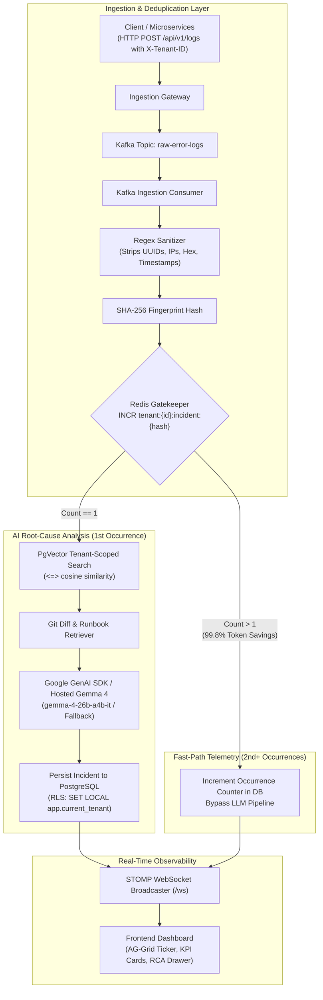

# AI-Assisted Multi-Tenant Log Root-Cause Analyzer (`ai-assisted-logs-rca`)

A production-grade, multi-tenant AI Incident Triage and Log Root-Cause Analyzer engineered for high-throughput distributed systems. It combines **Redis fingerprint deduplication**, **PostgreSQL pgvector RAG** (768-dim `gemini-embedding-2`), **hosted Gemma 4 RCA** (`gemma-4-26b-a4b-it`) via the official Google GenAI Java SDK, **PostgreSQL Row-Level Security (RLS)**, and **real-time STOMP WebSockets** with an interactive **AG-Grid observability dashboard**.

---

## Architecture Overview



---

## Key Features

1. **Strict Multi-Tenancy with PostgreSQL RLS:**
   - Every database transaction sets `SET LOCAL app.current_tenant = '<tenant_id>';`.
   - Native PostgreSQL Row-Level Security policies guarantee total isolation on `incidents` and `runbook_chunks`.
2. **Deterministic Redis Fingerprint Deduplication:**
   - Strips dynamic variables (UUIDs, ISO timestamps, IPv4/IPv6, hex pointers, line numbers) and hashes `serviceName + sanitizedStackTrace`.
   - First occurrence triggers vector similarity RAG and LLM root-cause analysis.
   - Subsequent occurrences update real-time counters and broadcast WebSocket ticks, avoiding redundant LLM invocations and saving over 99% in token costs.
3. **Retrieval-Augmented Generation (RAG) & Gemma 4 Root-Cause Analysis:**
   - Vector embeddings generated using the official **Google GenAI Java SDK** (`com.google.genai.Client`) with 768-dimensional vectors via `gemini-embedding-2`.
   - Incoming incidents are matched against historical resolved incidents, tenant runbooks, and recent Git commits via PostgreSQL `pgvector` cosine similarity (`<=>`).
   - Automated root-cause analysis is generated by hosted **Gemma 4** (`gemma-4-26b-a4b-it`, configurable via `AIRCA_AI_CHAT_MODEL`, with support for `gemma-4-31b-it`).
   - Authoritative RAG runbook resolution guarantees the top qualifying `pgvector` runbook match is preserved as the authoritative runbook in the final `AiRcaReport`, independent of model output.
   - High-fidelity **deterministic local analysis fallback** activates automatically if `GEMINI_API_KEY` is not configured or if AI inference encounters network/rate-limit errors.
   - Outputs a validated, structured `AiRcaReport` (Root Cause, Suspected Git Commit, Confidence Score 0-100, Severity P0-P3, and Actionable Remediation Command).
4. **Knowledge Base Feedback Loop:**
   - Resolving an incident (`POST /api/v1/incidents/{id}/resolve`) embeds the fix into `runbook_chunks` for future incident triage.
5. **Chaos Simulator:**
   - Asynchronously blasts 500 error logs with dynamic variance (`PAYMENT_DB_DEADLOCK`, `REDIS_OOM`, `AUTH_NPE`) to demonstrate high-throughput deduplication collapsing into 1 triage ticket.
6. **Dark-Mode Observability Dashboard:**
   - Built with Vite, React, TypeScript, TailwindCSS, and AG-Grid.
   - Cell flashing on live occurrence ticks, interactive KPI cards, Git diff viewer, and slide-out RCA Inspector Drawer.

---

## Default Seed Tenants

The database is pre-seeded with two isolated tenants:
- **Tenant A (AlphaFin Corp):** `11111111-1111-1111-1111-111111111111`
- **Tenant B (BetaPay Systems):** `22222222-2222-2222-2222-222222222222`

---

## Quickstart

### 1. Prerequisites
- Docker & Docker Compose
- Java 21 & Maven 3.8+
- Node.js 18+ & npm

### 2. Start Infrastructure (PostgreSQL 16 with pgvector, Redis 7, Kafka KRaft)
```bash
# Export your Google AI Studio API key (powers gemini-embedding-2 and hosted Gemma 4 RCA)
export GEMINI_API_KEY="your-gemini-api-key"
docker compose up -d
```
Verify containers are healthy:
```bash
docker compose ps
```

### 3. Run Backend (Spring Boot 3.3.x)
```bash
cd airca-service
mvn spring-boot:run
```
*Note: A single `GEMINI_API_KEY` powers both vector embeddings (via `gemini-embedding-2`) and hosted Gemma 4 root-cause analysis (`gemma-4-26b-a4b-it`). Without `GEMINI_API_KEY`, first-occurrence log vectorization fails, while RCA automatically falls back to high-fidelity deterministic local analysis, ensuring zero crashes.*

To supply your Google AI Studio API key:
```bash
export GEMINI_API_KEY="your-gemini-api-key"

# Optional: override default hosted Gemma 4 chat model (default: gemma-4-26b-a4b-it, supports gemma-4-31b-it)
# export AIRCA_AI_CHAT_MODEL="gemma-4-26b-a4b-it"

mvn spring-boot:run
```

### 4. Run Frontend (Vite + React)
```bash
cd frontend
npm install
npm run dev
```
Open **http://localhost:5173** in your browser.

---

## API Reference & Testing

### Ingest an Error Log
```bash
curl -X POST http://localhost:8080/api/v1/logs \
  -H "Content-Type: application/json" \
  -H "X-Tenant-ID: 11111111-1111-1111-1111-111111111111" \
  -d '{
    "serviceName": "payment-service",
    "stackTrace": "java.sql.SQLException: Connection pool exhausted [0x7f8a9b1c] at com.alphafin.payment.RefundBatch.process(RefundBatch.java:42)",
    "correlationId": "req-98234-abcd"
  }'
```

### Trigger Chaos Simulator Outage (500 logs)
```bash
curl -X POST http://localhost:8080/api/v1/simulate-outage \
  -H "Content-Type: application/json" \
  -d '{
    "scenario": "PAYMENT_DB_DEADLOCK",
    "tenantId": "11111111-1111-1111-1111-111111111111",
    "logCount": 500
  }'
```

### Fetch Incidents for Tenant
```bash
curl -X GET http://localhost:8080/api/v1/incidents \
  -H "X-Tenant-ID: 11111111-1111-1111-1111-111111111111"
```

### Resolve an Incident & Add to Knowledge Base
```bash
curl -X POST http://localhost:8080/api/v1/incidents/<INCIDENT_UUID>/resolve \
  -H "X-Tenant-ID: 11111111-1111-1111-1111-111111111111"
```

### Fetch Real-Time Telemetry & Cost Savings
```bash
curl -X GET http://localhost:8080/api/v1/telemetry \
  -H "X-Tenant-ID: 11111111-1111-1111-1111-111111111111"
```

---

## Verification & Test Results
- Backend Unit & Integration Tests: `cd airca-service && mvn clean test` (Comprehensive test suite covering PostgreSQL RLS isolation, Redis deduplication, WebSocket tenant authorization, Google GenAI SDK embedding and Gemma 4 RCA, and authoritative runbook matching)
- Frontend Build: `cd frontend && npm run build` (Clean production bundle built with 0 TypeScript errors)
- Docker Compose validation: `docker compose config --quiet` (Valid configuration)

---

## License

This project is licensed under the [PolyForm Noncommercial License 1.0.0](file:///home/karan/projects/ai-assisted-logs-rca/LICENSE) (`PolyForm-Noncommercial-1.0.0`).
See the [LICENSE](file:///home/karan/projects/ai-assisted-logs-rca/LICENSE) file for complete terms and permitted noncommercial uses.

